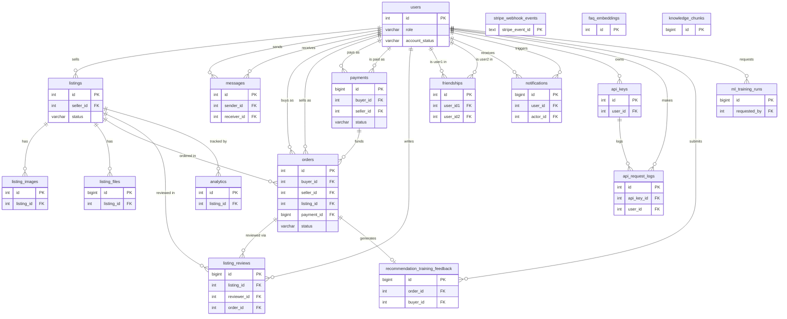

*This project has been created as part of the 42 curriculum by hwai-keo,
mbani-ya, hho-jia-, muhabin-, abin-moh.*

# Racketdiction Marketplace

A full-stack badminton and racket marketplace built with Next.js, Go Echo,
FastAPI, PostgreSQL with pgvector, and Docker Compose.

The local stack is protected by an OWASP CRS Web Application Firewall. Runtime
secrets are retrieved from Infisical Cloud and injected into Docker Compose by
the official Dockerized Infisical CLI.

## Description

**Racketdiction Marketplace** is a full-stack badminton/racket e-commerce
platform, built as the `ft_transcendence` "Surprise" project for the 42
curriculum. It lets buyers browse and buy rackets and gear from independent
sellers, and gives sellers the tools to list inventory, fulfill orders, and
track performance — wrapped in a production-shaped stack: a WAF-protected
perimeter, real Stripe payments, an AI shopping assistant, and a full
observability pipeline.

The goal was to build a complete, secure, production-shaped web application
that genuinely covers the curriculum's major modules (Web framework,
Cybersecurity, AI, DevOps, Data/Analytics, User management, Accessibility)
rather than bolting on a minimal demo of each one.

Key features:

- Product marketplace: listings, search/filter/sort/pagination, images and
  file attachments, buyer reviews
- Cart and checkout with real Stripe Connect payments (destination charges
  plus a platform fee)
- Seller dashboard: analytics, order fulfillment, bulk CSV import/export
- Friends and real-time WebSocket chat
- RacketBot: an AI assistant (RAG + tool calling) for product Q&A and
  recommendations
- ML-based product recommendations
- JWT auth with 2FA (OTP) and Google OAuth, plus a user/moderator/admin role
  system
- Public, rate-limited developer API secured with API keys
- Multi-language UI (English, Malay, Chinese)
- WAF (ModSecurity + OWASP CRS) perimeter and Infisical-managed secrets
- Full observability stack: Prometheus, Grafana, Loki, Alertmanager
- Scheduled PostgreSQL backups and disaster-recovery procedures

## Team Information

| Role                  | Name          | Login    | Responsibilities                                                                        |
| --------------------- | ------------- | -------- | ---------------------------------------------------------------------------------------- |
| Product Owner (PO)    | Ho Wai Keong  | hwai-keo | AI & seller-side product ownership: recommendations, RacketBot, uploads, permissions     |
| Project Manager (PM)  | Muhammad      | mbani-ya | Buyer-side features, core platform plumbing, security stack, project coordination        |
| Tech Lead             | Howard Ho Jia | hho-jia- | Data/analytics & UI: seller dashboard, public API, i18n, CSV import/export               |
| Developer             | Fadhlul       | muhabin- | DevOps (monitoring, health/disaster recovery), browser compatibility                     |
| Developer             | Muzzammil     | abin-moh | Architecture & project structure, DevOps (monitoring, health/disaster recovery)          |

See [Individual Contributions](#individual-contributions) below for a
detailed, per-person breakdown of what each role actually built.

## Project Management

### How work was organized

The team met weekly in person to review progress and agree on direction, and
coordinated day to day over a WhatsApp group. Tasks and decisions were tracked
in Notion, while concrete bugs and implementation work were tracked as GitHub
Issues tied to the code. The team agreed on the overall architecture together
before splitting up feature work.

Several teammates were also working full- or part-time jobs alongside the
project, which made consistent, day-to-day commitment hard to guarantee for
everyone. Instead of assigning work in a way that assumed equal availability,
the team divided the project structure — modules, features, and ownership
boundaries — around each person's actual work schedule and commitment
capacity, so slower weeks for one person didn't block the rest of the team.

### How work was distributed

- Architectural design & project structure — Muzzammil, Muhammad
- Buyer-side features — Muhammad
- AI and seller-side features — Ho Wai Keong
- Data statistics and UI — Howard Ho Jia
- DevOps — Muzzammil, Fadhlul

### Tools

- **Notion** — task and decision tracking, planning
- **GitHub Issues** — bug tracking and implementation tasks tied to code
- **Git / GitHub** — version control and code review

### Communication channels

- **WhatsApp** group — day-to-day coordination
- **Weekly in-person meetings** — progress review and decisions

## Technical Stack

| Layer                 | Technology                                                                                   | Why we chose it                                                                                                                                                                    |
| ---------------------- | ---------------------------------------------------------------------------------------------- | ------------------------------------------------------------------------------------------------------------------------------------------------------------------------------- |
| Frontend               | Next.js 15 (App Router), React 19, TypeScript                                                  | SSR-capable React framework with file-based routing; static typing keeps a five-person team's API contracts consistent                                                            |
| Frontend styling       | Tailwind v4                                                                                     | Utility-first styling ships UI fast without maintaining a separate design system or CSS-module tree                                                                                |
| Backend                | Go 1.25 + Echo                                                                                  | Compiled and statically typed, with lightweight goroutines for concurrent WebSocket chat and marketplace traffic; Echo is a minimal, well-documented HTTP framework on top of it   |
| Backend data access    | GORM + pgx                                                                                      | GORM makes the chores of communicating with database easier; pgx underneath it is a fast, native PostgreSQL driver rather than `database/sql` + a generic driver    |
| Database               | PostgreSQL 15 + pgvector                                                                        | One relational database serves both normal marketplace data and AI embeddings for RAG, instead of running a second dedicated vector store                                          |
| AI service             | Python + FastAPI + LangChain/LangGraph                                                          | Python is the de facto ecosystem for LLM tooling; FastAPI gives async, typed endpoints; LangGraph structures RacketBot's tool-calling agent loop                                    |
| LLM providers          | DeepSeek (chat/tool calling) + OpenRouter (embeddings)                                          | Splits inference across providers by task to control cost: conversational tool-calling vs. embedding generation                                                                    |
| Internal routing       | Nginx (internal reverse proxy)                                                                  | Single internal entry point that routes to frontend/backend by path, keeping service ports off the public network                                                                  |
| Perimeter security     | Nginx + ModSecurity + OWASP CRS (WAF)                                                           | Only the WAF publishes host ports; blocks SQLi/XSS/etc. at the edge before requests reach the app — required for the Cybersecurity/Fintech module                                  |
| Secrets management     | Infisical (Dockerized CLI)                                                                      | Centralizes runtime secrets instead of committing `.env` files; injected into containers at startup and never baked into an image                                                  |
| Auth                   | JWT + OTP (2FA) + Google OAuth                                                                  | Stateless session tokens, one-time codes for 2FA, and OAuth cover both the standard and the Fintech-tier user-management requirements                                              |
| Payments               | Stripe Connect (destination charges)                                                            | Handles seller payouts and platform fees on real payment rails instead of a custom ledger                                                                                          |
| Orchestration          | Docker Compose                                                                                  | Reproducible multi-service environment where every service (WAF, nginx, frontend, backend, ai, db, ops stack) starts from one definition                                          |
| Observability          | Prometheus, Grafana, Loki/Promtail, Alertmanager, node/cadvisor/postgres/blackbox exporters     | Metrics, dashboards, log aggregation, and alerting for the DevOps "good practice" module; all loopback-bound so they're never publicly exposed                                     |
| Backups                | Scheduled `pg_dump` (db-backup service)                                                         | Automated, retention-based backups back the disaster-recovery feature                                                                                                              |
| Internationalization   | Locale JSON catalogs (`en`, `ms`, `zh`)                                                          | Satisfies the multi-language accessibility requirement without a heavier i18n framework                                                                                            |
| Testing                | Vitest + Testing Library, Go `testing` with `-race`, Python `unittest`                          | Idiomatic per-service test tooling, all run in CI on every change                                                                                                                  |

## Database Schema

Everything in the schema hangs off one central `users` table — almost every
other table has a foreign key pointing back to a user, either as the owner,
buyer, seller, sender, or actor of that row. Grouped by what they're for:

- **Identity** — `users` holds accounts (local password or Google OAuth),
  profile info, role (user/moderator/admin), and account status.
- **Marketplace** — `listings` are the products for sale, each owned by a
  seller; `listing_images` and `listing_files` hold their photos/attachments,
  and `listing_reviews` holds buyer ratings after a completed purchase.
- **Transactions** — `orders` connect a buyer, a seller, and a listing;
  `payments` and `stripe_webhook_events` track the actual Stripe checkout
  behind an order.
- **Social** — `friendships`, `messages`, and `notifications` handle friend
  requests, chat, and in-app alerts between users.
- **Developer platform** — `api_keys` and `api_request_logs` support the
  public developer API and its audit trail.
- **AI/ML** — `recommendation_training_feedback` and `ml_training_runs` back
  the recommendation model; `faq_embeddings` and `knowledge_chunks` back
  RacketBot's RAG-based answers.
- **Misc** — `analytics` records lightweight listing events (e.g. views).

The authoritative schema is `db/init.sql`; run `make db-connect` and `\d+
<table>` against a running stack for the exact columns/types/constraints.

### Entity-relationship diagram



`faq_embeddings` and `knowledge_chunks` (RacketBot's RAG store) and
`stripe_webhook_events` (the webhook idempotency log) have no foreign keys
into the rest of the schema, so they're drawn as standalone entities above.

### Tables

Key fields per table — primary keys (PK), foreign keys (FK) and what they
point to, and the fields that define each table's behavior. This is a subset
of each table's columns, not the full list; see `db/init.sql` for every
column, default, and constraint.

#### users — accounts and identity

| Field                                  | Type          | Notes                                              |
| --------------------------------------- | ------------- | --------------------------------------------------- |
| `id`                                    | SERIAL        | PK                                                  |
| `username`, `email`                     | VARCHAR(255)  | both UNIQUE, NOT NULL                               |
| `password_hash`                         | VARCHAR(255)  | nullable — NULL for OAuth-only accounts             |
| `oauth_id`, `oauth_provider`            | VARCHAR       | set together for Google OAuth accounts              |
| `role`                                  | VARCHAR(20)   | `user` / `moderator` / `admin`                      |
| `account_status`                        | VARCHAR(20)   | `active` / `suspended` / `deleted`                  |
| `requires_2fa`                          | BOOLEAN       | gates the OTP step at login                         |
| `avatar_storage_name`, `avatar_mime_type` | VARCHAR     | back the controlled `/api/v1/users/<id>/avatar` route |

#### listings — marketplace products

| Field                                                        | Type          | Notes                                                  |
| -------------------------------------------------------------- | ------------- | --------------------------------------------------------- |
| `id`                                                          | SERIAL        | PK                                                      |
| `seller_id`                                                   | INT           | FK → `users.id`, `ON DELETE CASCADE`                    |
| `title`, `description`                                        | VARCHAR/TEXT  |                                                          |
| `price`, `original_price`                                     | DECIMAL(10,2) |                                                          |
| `stock_quantity`                                               | INT           | `CHECK >= 0`                                             |
| `status`                                                       | VARCHAR(20)   | `active` / `pending` / `sold` / `archived`               |
| `weight_category`, `flexibility_category`, `balance_category`  | VARCHAR       | racket spec facets used by search and the recommender     |

#### listing_images / listing_files — listing media

| Field                     | Type         | Notes                                                        |
| -------------------------- | ------------ | --------------------------------------------------------------- |
| `id`                       | SERIAL / BIGSERIAL | PK                                                        |
| `listing_id`               | INT          | FK → `listings.id`, `ON DELETE CASCADE`                          |
| `image_url` / `image_data` | VARCHAR/BYTEA | `listing_images`: at least one of the two must be set (`CHECK`) |
| `is_primary`               | BOOLEAN      | `listing_images`: which photo shows first                        |
| `storage_name`             | VARCHAR(255) | `listing_files`: UNIQUE generated filename on disk                |
| `file_kind`                | VARCHAR(20)  | `listing_files`: `image` / `document`                             |
| `size_bytes`                | BIGINT       | `listing_files`: `CHECK > 0`                                     |

#### messages / notifications — social & alerts

| Field                | Type         | Notes                                                        |
| ---------------------- | ------------ | ----------------------------------------------------------------- |
| `id`                    | SERIAL/BIGSERIAL | PK                                                            |
| `sender_id`, `receiver_id` | INT       | `messages`: both FK → `users.id`, `ON DELETE CASCADE`             |
| `is_read`               | BOOLEAN      | `messages`                                                          |
| `user_id`               | INT          | `notifications`: FK → `users.id`, `ON DELETE CASCADE` (recipient)  |
| `actor_id`              | INT          | `notifications`: FK → `users.id`, `ON DELETE SET NULL` (who triggered it) |
| `notification_type`     | VARCHAR(40)  | `notifications`: `message` / `friend_added` / `order_new` / `order_completed` / `review_added` |
| `data`                  | JSONB        | `notifications`: locale-agnostic payload the frontend renders      |

#### friendships

| Field                | Type    | Notes                                             |
| ---------------------- | ------- | ---------------------------------------------------- |
| `id`                    | SERIAL  | PK                                                 |
| `user_id1`, `user_id2`  | INT     | both FK → `users.id`, `ON DELETE CASCADE`; UNIQUE pair |
| `status`                | VARCHAR(20) | `pending` / `accepted` / `blocked`               |

#### orders / payments — transactions

| Field                        | Type          | Notes                                                              |
| ------------------------------ | ------------- | ----------------------------------------------------------------------- |
| `id`                            | SERIAL/BIGSERIAL | PK                                                                    |
| `buyer_id`, `seller_id`         | INT           | both tables: FK → `users.id`                                            |
| `listing_id`                    | INT           | `orders`: FK → `listings.id`, `ON DELETE RESTRICT` (preserves history)   |
| `payment_id`                    | BIGINT        | `orders`: FK → `payments.id`, nullable, `ON DELETE RESTRICT`             |
| `total_price`                   | DECIMAL(10,2) | `orders`                                                                |
| `status`                        | VARCHAR(20)   | `orders`: `pending` / `completed` / `cancelled` / `refunded`             |
| `checkout_request_id`           | UUID          | `payments`: UNIQUE                                                      |
| `amount_minor`, `platform_fee_minor` | BIGINT   | `payments`: smallest-currency-unit amounts                              |
| `status`                        | VARCHAR(20)   | `payments`: `initializing` / `pending` / `paid` / `failed` / `cancelled` / `expired` / `refunded` |
| `stripe_checkout_session_id`, `stripe_payment_intent_id` | TEXT | `payments`: UNIQUE when present |

`stripe_webhook_events` (PK `stripe_event_id TEXT`) records processed webhook
IDs for idempotency; it has no foreign keys.

#### listing_reviews

| Field           | Type    | Notes                                                     |
| ----------------- | ------- | -------------------------------------------------------------- |
| `id`               | BIGSERIAL | PK                                                            |
| `listing_id`       | INT     | FK → `listings.id`, `ON DELETE CASCADE`                        |
| `reviewer_id`      | INT     | FK → `users.id`, `ON DELETE CASCADE`                            |
| `order_id`         | INT     | FK → `orders.id`, `ON DELETE RESTRICT` (proof of purchase)      |
| `rating`           | SMALLINT | `CHECK BETWEEN 1 AND 5`                                        |
| —                  | —       | UNIQUE (`listing_id`, `reviewer_id`) — one review per buyer     |

#### api_keys / api_request_logs — developer platform

| Field           | Type   | Notes                                                    |
| ----------------- | ------ | -------------------------------------------------------------- |
| `id`               | SERIAL | PK                                                             |
| `user_id`          | INT    | `api_keys`: FK → `users.id`, `ON DELETE CASCADE`                |
| `key_hash`         | VARCHAR(255) | `api_keys`: UNIQUE, never the raw key                     |
| `rate_limit`       | INT    | `api_keys`: default 100                                        |
| `api_key_id`, `user_id` | INT | `api_request_logs`: both FK, `ON DELETE SET NULL` (keeps the audit trail after revocation) |
| `method`, `path`, `status` | VARCHAR/INT | `api_request_logs`: one row per public-API request  |

#### analytics

| Field         | Type   | Notes                                |
| --------------- | ------ | ---------------------------------------- |
| `id`             | SERIAL | PK                                     |
| `event_type`     | VARCHAR(50) | e.g. a listing view                |
| `listing_id`     | INT    | FK → `listings.id`                      |

#### recommendation_training_feedback / ml_training_runs — AI/ML

| Field                                    | Type    | Notes                                                    |
| ------------------------------------------ | ------- | -------------------------------------------------------------- |
| `id`                                        | BIGSERIAL | PK                                                            |
| `order_id`                                  | INT     | `recommendation_training_feedback`: FK → `orders.id`, UNIQUE, `ON DELETE CASCADE` |
| `buyer_id`                                  | INT     | `recommendation_training_feedback`: FK → `users.id`             |
| `age_group`, `gender`, `experience_level`, `play_style`, `budget_range` | VARCHAR | `recommendation_training_feedback`: controlled survey values that train the recommender |
| `requested_by`                              | INT     | `ml_training_runs`: FK → `users.id`, `ON DELETE SET NULL`       |
| `status`                                    | VARCHAR(20) | `ml_training_runs`: `queued` / `running` / `succeeded` / `failed` |
| `metrics`                                   | JSONB   | `ml_training_runs`                                             |
| `is_active`                                 | BOOLEAN | `ml_training_runs`: at most one row active (partial unique index) |

#### faq_embeddings / knowledge_chunks — RacketBot's RAG store

| Field           | Type          | Notes                                                       |
| ----------------- | ------------- | ------------------------------------------------------------ |
| `id`               | SERIAL/BIGSERIAL | PK                                                        |
| `chunk_text`       | TEXT          | the indexed passage                                          |
| `embedding`        | VECTOR(1536) / VECTOR | pgvector column; `faq_embeddings` is fixed at 1536 dims, `knowledge_chunks` records its dimension per ingestion |
| `search_vector`     | TSVECTOR      | `knowledge_chunks`: generated column, full-text-indexed (GIN) |
| `is_active`         | BOOLEAN       | `knowledge_chunks`: selects the live knowledge-base version   |

No foreign keys point into either table — RAG content is versioned and
ingested independently of marketplace data.

## Features List

Complete list of implemented, user-facing features:

| Feature                              | Description                                                                          | Owner(s)            |
| ------------------------------------- | -------------------------------------------------------------------------------------- | -------------------- |
| Product listings                      | Sellers create/edit/delete listings with photos and file attachments                  | hwai-keo             |
| Cart & checkout                       | Buyer cart, Stripe-hosted Checkout, order creation                                     | mbani-ya             |
| Stripe Connect payments               | Destination charges, platform fee, connected-account payouts                          | mbani-ya             |
| Product reviews                       | Buyers rate/review a listing after a completed purchase                               | mbani-ya             |
| Friends & real-time chat              | Friend requests plus WebSocket chat so buyers/sellers can negotiate                    | mbani-ya             |
| Advanced search & filtering           | Search, filters, sorting, and pagination across listings                              | mbani-ya             |
| File upload & management              | Shared upload system for listing photos/attachments and profile avatars               | hwai-keo             |
| ML-based recommendations              | Personalized product recommendation engine                                            | hwai-keo             |
| RacketBot (RAG + tool-calling AI)     | LLM chat assistant with retrieval-augmented answers and tool calling                   | hwai-keo             |
| Advanced permissions                  | User / moderator / admin roles with an admin control panel                            | hwai-keo             |
| Public developer API                  | Rate-limited, API-key-secured public API, 5 endpoints                                 | hho-jia-             |
| Seller analytics dashboard            | Views/sales analytics and order fulfillment tools for sellers                         | hho-jia-             |
| CSV import/export                     | Bulk listing import and data export for sellers                                       | hho-jia-             |
| Multi-language UI                     | English / Malay / Chinese locale support                                              | hho-jia-             |
| 2FA (OTP)                             | One-time-code second factor on login                                                  | mbani-ya             |
| Google OAuth                          | Sign-in via Google                                                                     | mbani-ya             |
| Standard user management & auth       | Accounts, sessions, JWT auth                                                           | mbani-ya, hwai-keo   |
| ORM data layer                        | GORM + pgx models and migrations                                                       | mbani-ya             |
| WAF + Infisical                       | ModSecurity/OWASP CRS perimeter, centrally managed secrets                            | mbani-ya             |
| Monitoring & observability            | Prometheus/Grafana/Loki/Alertmanager stack                                            | muhabin-, abin-moh   |
| Health check / disaster recovery      | `/health` endpoint plus scheduled, retention-based Postgres backups                    | muhabin-, abin-moh   |
| Browser compatibility                 | Additional browser support beyond the primary target                                  | muhabin-             |

## Modules

Modules chosen from the project subject, with point value, justification, how
each was implemented, and who owned it. Major modules are worth 2 points,
Minor modules 1 point.

| Section        | Points        | Feature                                                             | Justification                                                                                                                                                    | Implementation                                                                                                          | Owner              |
| -------------- | ------------- | --------------------------------------------------------------------- | ------------------------------------------------------------------------------------------------------------------------------------------------------------------ | -------------------------------------------------------------------------------------------------------------------------- | ------------------- |
| Web            | 2 — Major     | Allow users to interact with other users (friends and chat)         | Buyers and sellers need to negotiate and ask questions before a sale closes; a friends list plus real-time chat is the natural way to support that               | Go WebSocket hub (`hub.go`) + friends REST API, persisted in `friendships`/`messages`                                     | mbani-ya            |
| Web            | 1 — Minor     | File upload and management system                                   | Listings are useless without photos/attachments, and profiles need avatars, so a shared upload system covers both needs at once                                  | Shared upload handlers under `uploads/`/`avatar/`, referenced by `listing_images`/`listing_files`                          | hwai-keo            |
| Web            | 1 — Minor     | Advanced search functionality with filters, sorting, and pagination | A catalog with many listings is unusable without filtering, sorting, and pagination, so this was table stakes for the marketplace itself                         | Query-param filters/sort/pagination on the products endpoints                                                              | mbani-ya            |
| AI             | 2 — Major     | Recommendation system using machine learning                        | Personalized suggestions increase discovery and sales, and it gives the AI module real product value instead of a bolt-on demo                                   | `ai_service/recommender.py` model served via FastAPI, called from the backend                                             | hwai-keo            |
| Web            | 2 — Major     | Public API (secured, rate limited, 5 endpoints)                     | Exposing a rate-limited developer API lets external tools read listings/orders, extending the marketplace beyond just the web frontend                           | `/api/public/v1` routes, `X-API-Key` middleware + rate limiting, `api_request_logs` audit trail                            | hho-jia-            |
| Cybersecurity  | 2 — Major     | WAF + Infisical                                                     | The app handles PII and payments, so perimeter filtering (WAF) and centralized secret storage (Infisical) are the baseline for a Fintech-tier project            | nginx + ModSecurity + OWASP CRS container; secrets injected via the Dockerized Infisical CLI at startup                    | mbani-ya            |
| Data/Analytics | 2 — Major     | Advanced analytics dashboard (seller data)                          | Sellers need visibility into views and sales to run their store, and it directly satisfies the Data/Analytics module                                             | `backend/modules/order/dashboard/` aggregating `orders`/`analytics`, rendered in the frontend                                           | hho-jia-            |
| DevOps         | 2 — Major     | Monitoring (Prometheus/Grafana)                                     | Metrics and dashboards catch incidents before users report them, which is standard practice for any service running in Docker Compose                            | Prometheus scraping + exporters, Grafana dashboards, all loopback-bound                                                    | muhabin-/abin-moh   |
| User Mgmt      | 1 — Minor     | 2FA (two-factor auth)                                               | Accounts are tied to payment and personal data, so a second auth factor matches the project's Fintech framing                                                    | OTP generation/verification in the `auth` module, delivered via Brevo email                                                | mbani-ya            |
| User Mgmt      | 1 — Minor     | OAuth 2.0 (Google/42)                                                | Lets users sign in without creating another password, and shows a standards-based auth flow expected of a Fintech-tier project                                   | Google OAuth2 flow in the `auth` module, linked to `users`                                                                 | mbani-ya            |
| Web            | 1 — Minor     | Use an ORM for the database                                         | GORM cuts down hand-written SQL and makes schema changes across many related tables safer to review                                                              | GORM models + pgx driver in `backend/db.go` and module repositories                                                        | mbani-ya            |
| Accessibility  | 1 — Minor     | Support for additional browsers                                     | Standard web APIs already cover most browsers, so this was reachable with little extra work while broadening who can use the demo                                | Cross-browser CSS/JS compatibility fixes in the frontend                                                                   | muhabin-            |
| User Mgmt      | 2 — Major     | Standard user management and authentication                         | Every other module depends on having accounts and sessions, so this was built first and is a guaranteed, low-risk requirement to satisfy                         | JWT middleware (`myMiddleware/auth.go`), password hashing, `users` table                                                   | mbani-ya, hwai-keo  |
| Web            | 2 — Major     | Use a framework for both the frontend and backend                   | Next.js and Echo provide routing, middleware, and project structure for free instead of hand-rolling them, and is expected for a project this size               | Next.js 15 App Router frontend, Go + Echo backend                                                                          | mbani-ya            |
| Accessibility  | 1 — Minor     | Support for multiple languages (at least 3 languages)               | The team and likely users aren't all English speakers, and 3 locales (en/ms/zh) were reachable without a heavier i18n framework                                  | Locale JSON catalogs in `i18n/messages/{en,ms,zh}`                                                                          | hho-jia-            |
| Data/Analytics | 1 — Minor     | Data export and import functionality                                | Sellers with existing inventory need bulk CSV import instead of listing items one by one, so it pairs naturally with the seller dashboard                        | CSV importer (`backend/modules/listing/importcsv/`) + export in the seller dashboard                                                       | hho-jia-            |
| User Mgmt      | 2 — Major     | Advanced permissions system                                         | Admin controls already need a user/moderator/admin role distinction, so formalizing it as its own module was low additional cost                                 | Role column on `users` (user/moderator/admin) + admin route group/middleware                                              | hwai-keo            |
| AI             | 2 — Major     | Implement a complete LLM system interface                           | RacketBot (RAG + tool calling) builds directly on the recommendation module's AI service, so it reuses existing infrastructure rather than starting from scratch | LangGraph agent (`agent.py`) with RAG (`rag.py`) + tool calling (`tools.py`), proxied through the backend auth boundary    | hwai-keo            |
| DevOps         | 1 — Minor     | Health check / disaster recovery procedures                         | The `/health` endpoint and scheduled `pg_dump` backups were needed anyway for safe deploys, so documenting them as a module was nearly free                      | `/health` endpoint + scheduled `pg_dump` backup service with retention                                                     | muhabin-/abin-moh   |
| **Total**      | **29**        |

## Individual Contributions

- **Ho Wai Keong (PO, `hwai-keo`)** — Owned the AI and seller side of the
  product: the ML-based recommendation system, RacketBot (RAG + tool-calling
  LLM interface), the file upload/management system, and the advanced
  permissions (user/moderator/admin) system. Co-owned standard user management
  and authentication.
- **Muhammad (PM, `mbani-ya`)** — Owned buyer-side features and core platform
  plumbing: friends and real-time chat, advanced search/filtering/pagination,
  the ORM data layer, frontend/backend framework setup, 2FA, Google OAuth, and
  the WAF + Infisical cybersecurity stack. Co-owned standard user management
  and authentication, and co-led the architectural design and project
  structure with Muzzammil.
- **Howard Ho Jia (Tech Lead, `hho-jia-`)** — Owned data statistics and UI:
  the seller analytics dashboard, the public developer API (rate-limited, 5
  endpoints), multi-language support (en/ms/zh), and CSV data export/import.
- **Muzzammil (Developer, `abin-moh`)** — Co-led architectural design and
  project structure with Muhammad, and co-owned DevOps with Fadhlul:
  monitoring (Prometheus/Grafana) and health-check/disaster-recovery
  procedures.
- **Fadhlul (Developer, `muhabin-`)** — Co-owned DevOps with Muzzammil
  (monitoring, health-check/disaster-recovery), and additional browser
  compatibility support.

### Challenges

- **Choosing the architecture and framework stack.** Early on, the team
  wasn't certain which frameworks and overall architecture would hold up for
  a project this size — multiple services, a WAF, an AI service, and real
  payments all in one stack. To de-risk that decision, the team reached out
  to tech specialists working in industry for advice on framework and
  architecture choices, and used AI tools as a sounding board (see
  [AI usage](#ai-usage) under Resources) to explore trade-offs and build a
  shared understanding of unfamiliar concepts before committing. That input
  converged on the architecture described in
  [Technical Stack](#technical-stack) — Next.js + Go/Echo +
  PostgreSQL/pgvector behind an nginx + WAF perimeter — before feature work
  was split up.
- **Balancing the project against outside work commitments.** Several
  teammates were also working jobs alongside the project, which made
  consistent, day-to-day availability hard to guarantee across the whole
  team. Rather than assume everyone had equal time, the team addressed this
  by carefully dividing the project structure — module and feature
  boundaries, and who owned each one — around each person's actual work
  schedule and commitment capacity, so a busy week for one person didn't
  block progress for the rest of the team.

## Instructions

### Architecture

```text
Browser
  -> WAF (Nginx + ModSecurity + OWASP CRS)
  -> internal Nginx router
  -> frontend:3000 or backend:8080
                         -> db:5432
                         -> ai:8000
```

Only the WAF publishes host ports:

- HTTP: <http://localhost:8088>
- HTTPS: <https://localhost:8443>

These high-numbered ports work with rootless Docker, which cannot normally
bind ports below 1024. If either port is in use, choose free alternatives when
starting the stack, for example: `WAF_HTTP_PORT=8089 WAF_HTTPS_PORT=8444 make setup`.

The development HTTPS certificate is self-signed, so browsers and `curl` will
require an explicit local trust exception.

### Prerequisites

- Docker with Docker Compose v2
- Make
- curl
- Git
- A project-scoped Infisical programmatic access token

No local Infisical CLI installation or `sudo` access is required.

### One-time Infisical authentication setup

From the repository root:

```bash
make infisical-auth-init
nano .env.infisical-auth
chmod 600 .env.infisical-auth
```

Set `INFISICAL_TOKEN` in `.env.infisical-auth`. The token should be read-only
and scoped to this project and its `dev` environment. Normal startup is fully
non-interactive and never invokes Infisical login. The committed
`.infisical.json` contains only the project reference.

Required Infisical secrets at path `/`:

```text
DB_PASSWORD
JWT_SECRET
ADMIN_PASSWORD_HASH
DEEPSEEK_API_KEY
OPENROUTER_API_KEY
```

The full demo startup also requires the five persistent Stripe values
documented under
[Stripe Connect sandbox checkout](#stripe-connect-sandbox-checkout).

Requirements:

- `JWT_SECRET` must contain at least 32 characters.
- `ADMIN_PASSWORD_HASH` must be a bcrypt hash.
- `DB_PASSWORD` must match the password in an existing PostgreSQL volume.
- `BREVO_API_KEY` is required when demonstrating 2FA or password-change email.

Do not put real secret values in `.env.example` or tracked documentation.

### Start the application

```bash
make setup
```

`make setup` checks Docker and Compose, exports fresh `dev` secrets through the
Dockerized CLI, validates the five persistent Stripe values, starts the actual
persistent Stripe listener, extracts its signing secret without displaying it,
injects that value into the backend, and starts the complete stack. The
generated `.env.infisical` file has mode `600` and is removed as soon as
Compose finishes creating and starting the containers.

To require the optional Brevo credential as part of startup validation:

```bash
make setup REQUIRE_BREVO=1
```

Verify the running stack:

```bash
make ps
make health-check
make test-waf
```

### Existing PostgreSQL volumes

The `POSTGRES_PASSWORD` environment value initializes a new PostgreSQL volume;
it does not change the password in an existing `postgres_data` volume.

For an existing development volume, either:

1. use its current password as the initial Infisical `DB_PASSWORD`; or
2. connect with `make db-connect`, run `\password transcendence` interactively,
   and then set the same new value in Infisical.

Do not use `make clean` or `make reset` as a password migration unless deleting
all local database data is intentional.

### Common commands

```text
make help             Show all supported commands
make setup            Build the full demo stack and start Stripe forwarding
make up               Start the full stack and Stripe forwarding
make restart          Rebuild the full stack and Stripe forwarding
make check-secrets    Fetch and validate required secrets
make check-stripe-secrets Validate the complete Stripe demo configuration
make test-stripe-setup Test listener parsing and temporary-file cleanup
make infisical-auth-init  Create the local token file
make infisical-auth-check Validate the local token file
make infisical-auth-clear Delete only the local token file
make build            Build application images without retrieving secrets
make down             Stop containers without requiring Infisical
make ps               Show container status and published ports
make logs             Follow all logs
make logs-waf         Follow ModSecurity and CRS audit output
make logs-stripe      Follow the persistent Stripe webhook listener
make logs-backend     Follow Go backend logs
make logs-frontend    Follow Next.js logs
make logs-db          Follow PostgreSQL logs
make health-check     Check WAF and backend reachability
make test-waf         Run HTTP redirect, normal, SQLi, and XSS tests
make db-connect       Open psql in the database container
make db-migrate       Apply db/init.sql
```

`make clean` and `make reset` delete the PostgreSQL volume and all local
database data.

### Stripe Connect sandbox checkout

`make setup`, `make up`, and `make restart` all start the pinned Stripe CLI
listener alongside the application. The sandbox flow supports one configured
seller, MYR card payments, Stripe-hosted Checkout, Connect destination charges,
and a 10% application fee.

Store these values in the Infisical `dev` environment at path `/`:

```text
STRIPE_SECRET_KEY
STRIPE_TEST_CONNECTED_ACCOUNT_ID
STRIPE_TEST_SELLER_EMAIL
STRIPE_SUCCESS_URL
STRIPE_CANCEL_URL
```

Do not store `STRIPE_WEBHOOK_SECRET` in Infisical for this local workflow. It is
generated from the actual listener container on every startup and exists only
in the protected temporary environment file used to create the backend.

Use a test key beginning with `sk_test_`. The connected account ID begins with
`acct_`. Choose the stable email address of the marketplace demo seller with:

```bash
make db-connect
```

```sql
SELECT username, email
FROM users
ORDER BY email;
```

Set `STRIPE_TEST_SELLER_EMAIL` to that address. Checkout compares the configured
address with the listing seller's database email after trimming whitespace and
without case sensitivity, so it remains stable when a fresh PostgreSQL volume
assigns different numeric user IDs.

Recommended local return URLs are:

```text
STRIPE_SUCCESS_URL=https://localhost:8443/cart?checkout=stripe-return&session_id={CHECKOUT_SESSION_ID}
STRIPE_CANCEL_URL=https://localhost:8443/cart?checkout=stripe-cancelled
```

If `WAF_HTTPS_PORT` is customized, use that port in both URLs.

The fresh-machine workflow is:

```bash
make setup
make logs-stripe
make down
```

Run `make logs-stripe` in a second terminal when you want to watch forwarding.
Setup waits for the actual detached listener's readiness output, parses its
`whsec_` value without printing it, adds it only to the mode-600 temporary
environment file, and recreates the backend with that exact value. It then
checks that the same listener container is still running and that the backend
container received the identical secret.

The listener forwards only the required events to
`http://backend:8080/api/v1/webhooks/stripe`; it does not publish the backend
port or persist the API key. `make logs-stripe` redacts the generated signing
secret before displaying listener output.

Use Stripe's sandbox card:

```text
4242 4242 4242 4242
Any future expiry
Any three-digit CVC
```

After payment, verify the destination charge, 10% application fee, and
connected-account transfer in the Stripe test dashboard. Inspect local state
with:

```bash
make db-connect
```

```sql
SELECT id, status, amount_minor, platform_fee_minor,
       stripe_checkout_session_id, stripe_payment_intent_id, stock_released
FROM payments
ORDER BY id DESC;

SELECT id, payment_id, status, payment_method
FROM orders
ORDER BY id DESC;
```

The verified webhook, not the browser return URL, marks a payment paid. A
declined card leaves stock reserved so the buyer can retry in the same Checkout
Session. An expired Session cancels its pending orders and restores stock
exactly once.

Current limitations: test mode only, one configured seller, one seller per
Stripe cart, MYR cards only, no dynamic onboarding, and no refund initiation or
refund webhook synchronization.

### WAF demonstration

Run:

```bash
make test-waf
```

The expected result is:

```text
HTTP to HTTPS redirect              301 or 308
Normal backend request              200
SQL injection request               403
XSS request                         403
```

Then inspect the rule matches:

```bash
make logs-waf
```

The committed WAF configuration uses blocking mode and CRS paranoia level 1.
Do not disable ModSecurity for all of `/api/`. If a legitimate request is
blocked, identify the rule and add the narrowest route- or parameter-specific
exclusion.

### Application validation

After changing the stack, test:

- frontend loading and login;
- product listing and CRUD operations;
- avatar upload;
- up to six listing images of 10 MiB each;
- WebSocket chat;
- progressively streamed AI responses;
- administrator login and user management.

Service-specific checks:

```bash
cd backend
go test ./...
go build ./...
```

```bash
cd frontend
npm run build
```

```bash
cd ai_service
python -m py_compile *.py
python -m unittest discover -s tests -v
```

### Troubleshooting

#### This clone is not linked to Infisical

Restore the team-owned `.infisical.json` file from the repository. It contains
the Infisical project reference but no secret values.

#### Infisical secret validation fails

Run `make infisical-auth-check`, confirm that the token has project access, and
check that the required names exist in environment `dev` at path `/`. The
validation scripts never print the token or secret values.

#### Database authentication fails after migration

The Infisical value probably differs from the password stored in the existing
PostgreSQL volume. Follow the existing-volume procedure above. Do not delete the
volume if its data must be retained.

#### A legitimate request returns 403

Inspect:

```bash
make logs-waf
```

Record the CRS rule ID, verify the request is legitimate, and add only a narrow
exclusion. Retest both the application flow and `make test-waf`.

#### Docker is unavailable in WSL

Start Docker Desktop and enable integration for the active WSL distribution,
then rerun `make setup`.

## Resources

### AI usage

AI assistants (LLM-based tools, including Claude Code) were used during the
**architecture and design phase** of the project — helping the team explore
trade-offs between candidate frameworks/architectures and build a shared
understanding of concepts that were new to the team (e.g. Retrieval-Augmented
Generation, WAF/ModSecurity rule behavior, WebSocket-based real-time chat,
Stripe Connect's destination-charge model) before committing to the stack
described in [Technical Stack](#technical-stack). This ran alongside direct
input from industry tech specialists the team consulted on framework and
architecture choices — see
[Challenges](#challenges) under Individual Contributions.

### Classic references

- [Next.js documentation](https://nextjs.org/docs) — App Router, SSR
- [React documentation](https://react.dev/) — component model, hooks
- [Echo framework guide](https://echo.labstack.com/docs) — Go HTTP routing
  and middleware
- [GORM documentation](https://gorm.io/docs/) — ORM models and migrations
- [pgx documentation](https://pkg.go.dev/github.com/jackc/pgx/v5) — native
  PostgreSQL driver for Go
- [PostgreSQL documentation](https://www.postgresql.org/docs/) — relational
  database reference
- [pgvector](https://github.com/pgvector/pgvector) — vector similarity search
  extension for PostgreSQL
- [LangChain documentation](https://python.langchain.com/docs/introduction/)
  and [LangGraph documentation](https://langchain-ai.github.io/langgraph/) —
  RAG pipelines and agent/tool-calling orchestration
- [FastAPI documentation](https://fastapi.tiangolo.com/) — async Python API
  framework
- [OWASP ModSecurity Core Rule Set](https://coreruleset.org/docs/) —
  WAF rule set and paranoia levels
- [Stripe Connect documentation](https://docs.stripe.com/connect) —
  destination charges and platform fees
- [JWT introduction (jwt.io)](https://jwt.io/introduction) — token structure
  and validation
- [OAuth 2.0](https://oauth.net/2/) and
  [Google Identity Platform docs](https://developers.google.com/identity) —
  OAuth sign-in flow
- [Prometheus documentation](https://prometheus.io/docs/introduction/overview/)
  and [Grafana documentation](https://grafana.com/docs/) — metrics and
  dashboards
- [Infisical documentation](https://infisical.com/docs/documentation/getting-started/introduction) —
  secrets management

### Project documentation

- [docs/prd-cybersecurity-waf-infisical.md](docs/prd-cybersecurity-waf-infisical.md) —
  detailed cybersecurity (WAF + Infisical) requirements
- [AGENTS.md](AGENTS.md) — long-form contributor/agent guide: coding
  conventions per subsystem, security boundaries, validation rules

## License

42 Project - Transcendence
