# Database Schema Reference

PostgreSQL 15 + pgvector. Source of truth is the live schema (`\d` on each
table) plus what actually reads/writes each column in the Go backend and
Python AI service — not just what `db/init.sql` declares. Where a
table/column is unused by any code, it's marked **(unused)**.

The `otps` table is not in `db/init.sql` — it's created by GORM's
`AutoMigrate` in `backend/modules/user`.

---

## Entity-relationship diagram

Declared foreign keys only. `users` is the hub: almost every marketplace,
social, payment, and developer-API table points at it. Isolated tables
(`otps`, `stripe_webhook_events`, `knowledge_chunks`, `faq_embeddings`) have
no FKs.

Cardinality: `||--o{` = one-to-many, `||--o|` = one-to-zero-or-one.
Edge labels are the FK column and `ON DELETE` action. Mermaid only allows one
`PK` / `FK` / `UK` tag per entity, so those markers are omitted from columns
and the relationships carry the foreign keys. `users.account_role` in the
graph is the `users.role` column (`user` / `moderator` / `admin`).

```mermaid
erDiagram
    users {
        serial id PK
        varchar username
        varchar email
        varchar password_hash
        varchar account_role
        varchar account_status
        varchar oauth_id
        varchar oauth_provider
        boolean requires_2fa
    }

    listings {
        serial id PK
        int seller_id
        varchar title
        numeric price
        int stock_quantity
        varchar status
        int views_count
    }

    listing_files {
        bigserial id PK
        int listing_id
        varchar storage_name
        varchar file_kind
        int display_order
    }

    listing_images {
        serial id PK
        int listing_id
        varchar image_url
        boolean is_primary
    }

    orders {
        serial id PK
        int buyer_id
        int seller_id
        int listing_id
        bigint payment_id
        int quantity
        numeric total_price
        varchar status
        varchar payment_method
    }

    payments {
        bigserial id PK
        uuid checkout_request_id
        int buyer_id
        int seller_id
        varchar status
        bigint amount_minor
        text stripe_checkout_session_id
    }

    listing_reviews {
        bigserial id PK
        int listing_id
        int reviewer_id
        int order_id
        smallint rating
    }

    recommendation_training_feedback {
        bigserial id PK
        int order_id
        int buyer_id
        varchar age_group
        varchar play_style
        varchar weight_category
    }

    messages {
        serial id PK
        int sender_id
        int receiver_id
        text content
        boolean is_read
    }

    friendships {
        serial id PK
        int user_id1
        int user_id2
        varchar status
    }

    notifications {
        bigserial id PK
        int user_id
        int actor_id
        varchar notification_type
        int resource_id
        timestamptz read_at
    }

    api_keys {
        serial id PK
        int user_id
        varchar key_hash
        boolean is_active
        int rate_limit
        timestamp expires_at
    }

    api_request_logs {
        serial id PK
        int api_key_id
        int user_id
        varchar method
        varchar path
        varchar outcome
    }

    ml_training_runs {
        bigserial id PK
        int requested_by
        varchar status
        boolean is_active
        varchar model_version
    }

    analytics {
        serial id PK
        varchar event_type
        int listing_id
    }

    otps {
        varchar email PK
        char code
        timestamptz expiry_date
        boolean used
        varchar temp_token
    }

    stripe_webhook_events {
        text stripe_event_id PK
        text event_type
        text stripe_object_id
        timestamp processed_at
    }

    knowledge_chunks {
        bigserial id PK
        varchar chunk_id
        varchar ingestion_version
        boolean is_active
        vector embedding
        tsvector search_vector
    }

    faq_embeddings {
        serial id PK
        varchar source_file
        text chunk_text
        vector embedding
    }

    users ||--o{ listings : "seller_id CASCADE"
    users ||--o{ orders : "buyer_id CASCADE"
    users ||--o{ orders : "seller_id CASCADE"
    users ||--o{ payments : "buyer_id RESTRICT"
    users ||--o{ payments : "seller_id RESTRICT"
    users ||--o{ listing_reviews : "reviewer_id CASCADE"
    users ||--o{ messages : "sender_id CASCADE"
    users ||--o{ messages : "receiver_id CASCADE"
    users ||--o{ friendships : "user_id1 CASCADE"
    users ||--o{ friendships : "user_id2 CASCADE"
    users ||--o{ notifications : "user_id CASCADE"
    users ||--o| notifications : "actor_id SET NULL"
    users ||--o{ api_keys : "user_id CASCADE"
    users ||--o{ api_request_logs : "user_id SET NULL"
    users ||--o{ recommendation_training_feedback : "buyer_id CASCADE"
    users ||--o{ ml_training_runs : "requested_by SET NULL"

    listings ||--o{ listing_files : "listing_id CASCADE"
    listings ||--o{ listing_images : "listing_id CASCADE"
    listings ||--o{ orders : "listing_id RESTRICT"
    listings ||--o{ listing_reviews : "listing_id CASCADE"
    listings ||--o{ analytics : "listing_id default"

    payments ||--o{ orders : "payment_id RESTRICT"

    orders ||--o| listing_reviews : "order_id RESTRICT"
    orders ||--o| recommendation_training_feedback : "order_id CASCADE"

    api_keys ||--o{ api_request_logs : "api_key_id SET NULL"
```

### How to read the edges

| Relationship | Meaning in this product |
|---|---|
| `users` → `listings` | A seller owns many listings; deleting the seller cascades the ads |
| `listings` → `orders` | One listing, many order rows over time (cancel then sell again). **RESTRICT** so deleting an ad cannot erase purchase history |
| `users` → `orders` (buyer **and** seller) | Both parties are denormalized on the order; meetup carts may mix sellers |
| `payments` → `orders` | One Stripe payment can fund several same-seller order lines; meetup orders have `payment_id` NULL |
| `orders` → `listing_reviews` | At most one review per buyer per listing, only after a completed order |
| `orders` → `recommendation_training_feedback` | At most one survey per order |
| `users` ↔ `messages` / `friendships` | Two FKs to `users` on the same row (sender/receiver, user_id1/user_id2) |
| `notifications.actor_id` | Optional; **SET NULL** so the bell item survives if the actor is deleted |
| `api_keys` → `api_request_logs` | **SET NULL** so revoking a key does not wipe the audit trail |
| `ml_training_runs.requested_by` | **SET NULL** so training history survives the admin account |

### Present, but not drawn as an edge

These columns exist but are **not** foreign keys:

- `notifications.resource_id` — listing, order, or message ID depending on `notification_type`
- `stripe_webhook_events.stripe_object_id` — Stripe session/intent string, not `payments.id`
- `otps.email` — primary key is the email string, not `users.id`
- `knowledge_chunks` / `faq_embeddings` — standalone RAG stores; no user or listing FK

Unused tables still have FKs and appear above: `listing_images`, `analytics`,
`faq_embeddings`. They are not written by current application code.

---

## users

Account records for every person on the platform.

| Column | Type | Use |
|---|---|---|
| `id` | serial PK | Primary key, referenced by nearly every other table |
| `username` | varchar(255) unique | Login identity / display name |
| `email` | varchar(255) unique | Login identity, contact |
| `password_hash` | varchar(255) | bcrypt hash, checked at login — never the raw password |
| `first_name`, `last_name` | varchar(50) | Display name |
| `phone_no` | varchar(30) | Contact number, edited via `/profile/change-phoneNo` |
| `address` | varchar(255) | Delivery address, one per account, edited on the profile page. Reaches only its owner (`GET /api/v1/me`) and the seller of an order that buyer placed (`GET /api/v1/seller/orders`, scoped to `o.seller_id = <caller>`) |
| `date_of_birth` | date | Profile field |
| `gender` | varchar(10) | Profile field, CHECK constrained to `Male`/`Female` |
| `avatar_url` | varchar(255) | Link-based avatar (e.g. external URL) |
| `avatar_data` | bytea | Alternative: raw avatar image bytes stored in-row |
| `avatar_mime_type` | varchar(50) | Required if `avatar_data` is set |
| `bio` | text | Free-text profile blurb |
| `is_verified` | boolean | Set true after email/OTP verification |
| `requires_2fa` | boolean | Gates the OTP step in `Login()` — see `backend/modules/user/auth/handler.go` |
| `oauth_id`, `oauth_provider` | varchar | Google OAuth identity. Unique together via the partial index `idx_users_oauth_identity` (only when both are non-NULL), so a Google account maps to exactly one user |
| `created_at`, `updated_at` | timestamp | Audit timestamps |

---

## listings

The product catalog — one row per item a seller has posted. Despite the
table name, this **is** "products" (see `docs/prd-seller-analytics-dashboard.md`
§ for the listings-vs-orders distinction). Each listing is a single
secondhand item, sold at most once.

| Column | Type | Use |
|---|---|---|
| `id` | serial PK | Product ID, used in `/products/:id` URLs |
| `seller_id` | int FK → users | Who's selling it; cascades delete with the seller |
| `title`, `description` | varchar/text | The ad copy |
| `weight_category`, `flexibility_category`, `balance_category` | varchar(100) | Badminton-racket spec fields (e.g. "3U", "Stiff Shaft", "Head Heavy") — used as filter facets on browse |
| `category` | varchar(100), default `'Others'` | Broad category (Rackets/Footwear/Apparel/etc.) — drives the Analytics dashboard's category breakdown |
| `condition` | varchar(50), default `'Second-hand (Used)'` | Item condition |
| `dealing_method` | varchar(100), default `'Meet Up'` | How buyer/seller exchange the item |
| `phone_number` | varchar(20) | Contact number specific to this listing (separate from the seller's account phone) |
| `price` | numeric(10,2) | Current asking price |
| `original_price` | numeric(10,2) | Shown crossed-out for "was RM X" discount display |
| `currency` | varchar(10), default `'RM'` | Not used for actual multi-currency logic anywhere |
| `location` | varchar(100) | Where the item is |
| `image` | varchar(255) | Primary/cover image path |
| `seller_name` | varchar(255) | Denormalized copy of the seller's name |
| `rating`, `reviews` | numeric/int | Cached average rating + count shown on the card — **not** computed from the `reviews` table; static/seed values |
| `is_new` | boolean | "Brand new" badge |
| `is_featured` | boolean | Promotes to featured/homepage sections |
| `stock_quantity` | int NOT NULL, default 1, CHECK `>= 0` | Units available — the lot size. **Both** checkout paths require the buyer to take the whole lot (`item.Quantity != stockQuantity` → 409 "This listing must be bought in full") and zero it; a seller wanting to sell smaller amounts splits the lot into separate listings. Added to existing volumes by a `backend/db.go` migration, so it is not in every old dump |
| `status` | varchar(20), default `'active'` | `active` / `pending` / `sold` / `archived` — all four are real stored values (CHECK `listings_status_allowed`; existing volumes get the fourth value via the migration at `backend/db.go` that drops the old three-value `listings_status_check`). Drives My Shop tabs and the seller dashboard funnel. `pending` is written at checkout — the item is reserved but not yet handed over — and becomes `sold` only when the seller confirms. **Also computed at display time:** `getSellerDashboardItems` in `backend/seller_dashboard.go` still overrides the stored value with `pending` for any non-archived listing that has an order in `orders.status='pending'`, so a listing that sold part of its stock and still owes a handover surfaces as needing action |
| `views_count` | int, default 0 | Page-view counter, incremented by `recordListingView()` in `backend/products.go` on each `GET /products/:id` (skipped if the viewer is the seller) |
| `created_at`, `updated_at` | timestamp | Audit timestamps; `created_at` is also "date posted" and the anchor for days-listed/time-to-sell calculations |

---

## listing_images

Meant to hold multiple photos per listing. **Effectively unused** —
`uploadListingImages()` in `backend/products.go` writes files straight to
`static/listings/{listingId}_{index}.ext` on disk and only updates
`listings.image`; it never inserts a row here.

| Column | Type | Use |
|---|---|---|
| `id` | serial PK | Row ID |
| `listing_id` | int FK → listings | Which listing this image belongs to |
| `image_url` | varchar(255) | Path/URL to the image |
| `image_data` | bytea | Alternative: raw bytes stored in-row |
| `mime_type` | varchar(50) | Required if `image_data` is set (CHECK constraint) |
| `is_primary` | boolean | Marks the cover image among several |
| `uploaded_at` | timestamp | Audit timestamp |

---

## listing_files

The attachment table that `listing_images` never became. **Actively used** by
`backend/listing_files.go` — images and documents attached to a listing, with
the bytes on disk and only metadata here.

| Column | Type | Use |
|---|---|---|
| `id` | bigserial PK | Row ID |
| `listing_id` | int FK → listings, CASCADE | Which listing owns the file |
| `original_name` | varchar(255) | The filename the uploader chose, shown in the UI |
| `storage_name` | varchar(255) unique | Generated name on disk — never the user's, so an upload can't pick its own path |
| `file_kind` | varchar(20), CHECK | `image` or `document` |
| `mime_type` | varchar(100) | Sent as `Content-Type` when serving, rather than trusting the extension |
| `size_bytes` | bigint, CHECK `> 0` | Size, enforced non-empty |
| `display_order` | int, default 0 | Ordering within a listing |
| `created_at` | timestamp | Audit timestamp |

Indexed by `idx_listing_files_listing_order` on
`(listing_id, file_kind, display_order, id)`.

---

## orders

Purchase records — **one row per listing bought**, not one row per checkout.
See "One checkout creates many order rows" below before assuming an order can
span several listings.

| Column | Type | Use |
|---|---|---|
| `id` | serial PK | Order ID. Unique per *line*, so a 3-item cart produces 3 different ids |
| `buyer_id` | int FK → users, CASCADE | Who bought it |
| `seller_id` | int FK → users, CASCADE | Who sold it (denormalized copy of the listing's seller, so dashboard queries don't have to join `listings`) |
| `listing_id` | int FK → listings, **RESTRICT** | What was bought — exactly one listing per row. RESTRICT, not CASCADE: an order is financial history for both parties, so deleting a listing must not erase a buyer's purchase record or the revenue the seller dashboard reports |
| `quantity` | int, default 1 | Units in this order, taken out of `listings.stock_quantity` at checkout |
| `total_price` | numeric(10,2) | Amount charged for this line (unit price × quantity) |
| `status` | varchar(20), default `'pending'` | `pending` / `completed` / `cancelled` / `refunded`. `pending` = created at checkout, awaiting the seller marking it complete (`PUT /orders/:id/complete`); only `completed` counts as real revenue on the seller dashboard, and only `pending` counts toward the dashboard's "Pending Orders" tile |
| `payment_method` | varchar(50) | `"meetup"` (the default when the request omits it) or `"stripe"`; `createOrders` rejects anything else |
| `payment_id` | bigint FK → payments, RESTRICT | Set only on the Stripe path. **This is the grouping key** — every line of one Stripe checkout shares it. NULL for meetup orders. Added by a `backend/db.go` migration, not present in `db/init.sql`; indexed by `idx_orders_payment_id` |
| `created_at`, `updated_at` | timestamp | `created_at` anchors the monthly revenue chart and time-to-sell calc |

### One checkout creates many order rows

`POST /api/v1/orders` takes an `items` array, and the insert sits **inside a
loop over that array** (`backend/orders.go`). One listing per row, one row per
item, each with its own `id`. There is no `order_items` table and no
"parent order" row.

A cart of three listings from buyer 42, paid by meetup:

| id | buyer_id | seller_id | listing_id | quantity | total_price | status | payment_method | payment_id |
|---|---|---|---|---|---|---|---|---|
| 1001 | 42 | 7 | 10 | 1 | 50.00 | pending | meetup | NULL |
| 1002 | 42 | 7 | 17 | 1 | 120.00 | pending | meetup | NULL |
| 1003 | 42 | 9 | 23 | 1 | 80.00 | pending | meetup | NULL |

Three ids, not one. Note `seller_id` differs on the last row — a meetup cart
may mix sellers, and each seller only ever sees their own line.

The same cart paid by Stripe, which requires a single seller ("Stripe checkout
supports items from one seller only", 409), so listing 23 has to be a separate
checkout:

| id | buyer_id | seller_id | listing_id | quantity | total_price | status | payment_method | payment_id |
|---|---|---|---|---|---|---|---|---|
| 1004 | 42 | 7 | 10 | 1 | 50.00 | pending | stripe | 900 |
| 1005 | 42 | 7 | 17 | 1 | 120.00 | pending | stripe | 900 |

Still two ids — but both carry `payment_id = 900`, so `WHERE payment_id = 900`
reconstructs the basket. Meetup orders have no such key; the only thing tying
1001–1003 together is the same `buyer_id` and a `created_at` from the same
transaction.

Consequences worth remembering:

- **Completion is per line.** `PUT /orders/1001/complete` flips only 1001;
  1002 stays `pending`. A buyer can end up with one line completed, one
  cancelled, and one still pending out of a single checkout.
- **The same `listing_id` cannot appear twice in one checkout** — `createOrders`
  rejects a duplicate with 400 "duplicate listingId in checkout". Repeat units
  go in `quantity`, not in a second item.
- Revenue sums add up lines, never orders: `SUM(total_price) WHERE status='completed'`.

### Checkout flow

`POST /api/v1/orders` (`createOrders`) validates the items, then branches on
`payment_method`:

- **meetup** — opens one transaction, and per item locks the listing
  (`SELECT ... FOR UPDATE`), rejects self-purchase (403) and non-`active`
  listings (409), requires the buyer to take the **entire stock** (409 "This
  listing must be bought in full"), inserts the order as `pending`, then sets
  the listing to `stock_quantity = 0, status = 'pending'` — reserved, *not*
  sold.
- **stripe** — delegates to `stripePayments.CreateCheckout`
  (`backend/stripe_payments.go`), which inserts a `payments` row first, then
  one order per item carrying that `payment_id`. It enforces the same whole-lot
  rule and leaves the listing at `stock_quantity = 0, status = 'pending'`, so
  both paths reach an identical listing state. It additionally requires every
  item to come from one seller (409). If the Checkout Session then fails,
  `releaseReservedStock` returns the units and flips the listing back to
  `active`.

Either way the seller confirms with `PUT /api/v1/orders/:id/complete`
(`completeOrder`), which flips that one order to `completed`.

### Why `orders.status` exists separately from `listings.status`

They overlap on the word `pending` but track two different things, and
**one listing can have many orders**:

- `listings.status` (`active`/`pending`/`sold`/`archived`) answers *"is this
  item still for sale?"* — necessarily one value per listing.
- `orders.status` (`pending`/`completed`/`cancelled`/`refunded`) answers
  *"what happened to this specific transaction?"* — one value **per order**,
  and a listing accumulates several over time.

Since listings sell whole, a listing has at most one *completed* order — but
it still accumulates order rows, because cancelling frees it to be sold again.

That ceiling of one is enforced, not just conventional: `updateProduct`
(`backend/products.go`) refuses to edit a `sold` listing, and refuses to move
any listing back to `active` once it has a completed order — including the
archive-then-Republish route round it. A seller with another of the same item
posts a new listing, so the second sale gets its own row and its own history.

| When | Event | `orders` rows | `listings.status` |
|---|---|---|---|
| Jan 2 | seller posts it | *(none)* | `active` |
| Jan 5 | buyer A checks out | 1001 `pending` | `pending` |
| Jan 7 | buyer A cancels | 1001 **`cancelled`** | `active` |
| Jan 9 | buyer B checks out | 1001 `cancelled`, 1002 `pending` | `pending` |
| Jan 14 | seller confirms | 1001 `cancelled`, 1002 **`completed`** | `sold` |

One listing value at the end, two order values. There is nowhere on the
listing for `cancelled` to live — `listings.status` says `sold`, which is
true, but it cannot also record that a buyer backed out first. That history
matters: buyer A needs the cancelled order in their purchase list, and the
seller needs to tell a clean sale from a second attempt.

The deeper split: **`listings.status` is state, `orders.status` is history.**
The listing column only ever describes *now* and is overwritten four times
above — it has no memory. Each order row is permanent; nothing ever rewrites
1001. `orders.status` is also the only place `cancelled` and `refunded` can be
represented at all; those are outcomes of one transaction, not states an item
can be in. Conversely `archived` is a seller's shelf decision with no buyer
involved, so it is meaningless as a transaction outcome.

This is also why `getSellerDashboardItems` counts **pending orders**
(`COUNT(*) FROM orders WHERE listing_id = ... AND status = 'pending'`) rather
than trusting `listings.status` alone. `listings.status` can only say
"something is pending on this item"; the per-transaction truth — how many, and
which ones — lives only in the `orders` table, so the dashboard derives the
override fresh on every request.

---

## payments

Stripe checkout records, separate from order fulfilment. **Actively used** by
`backend/stripe_payments.go`. One payment funds one-or-more same-seller order
rows; meetup orders have no payment row at all (`orders.payment_id` is NULL).

| Column | Type | Use |
|---|---|---|
| `id` | bigserial PK | Payment ID, referenced by `orders.payment_id` |
| `checkout_request_id` | uuid unique | Client-supplied idempotency handle — a retried checkout reuses the same payment instead of charging twice |
| `stripe_idempotency_key` | varchar(255) unique | Passed to Stripe so a retried API call is not a second charge |
| `buyer_id`, `seller_id` | int FK → users, **RESTRICT** | The two parties; deleting either is blocked while a payment exists |
| `provider` | varchar(20), CHECK `= 'stripe'` | Only provider supported |
| `currency` | char(3), CHECK `= 'myr'` | Only currency supported |
| `amount_minor` | bigint, CHECK `> 0` | Total in sen (minor units), avoiding float rounding |
| `platform_fee_minor` | bigint, CHECK `0 ≤ fee ≤ amount` | Marketplace's cut |
| `status` | varchar(20), CHECK | `initializing` / `pending` / `paid` / `failed` / `cancelled` / `expired` / `refunded` |
| `stripe_checkout_session_id` | text | Stripe session; partial-unique when non-NULL |
| `stripe_checkout_url` | text | Where the buyer is sent to pay |
| `stripe_payment_intent_id` | text | Stripe intent; partial-unique when non-NULL |
| `session_expires_at` | timestamp | When the Stripe session lapses |
| `stock_released` | boolean, default false | Guards the reserved stock from being returned twice when a session expires |
| `created_at`, `updated_at` | timestamp | Audit timestamps |

---

## stripe_webhook_events

Replay guard for Stripe webhooks. **Actively used** by
`backend/stripe_webhooks.go` — Stripe redelivers events, so the ID is recorded
and a repeat delivery is skipped rather than processed twice.

| Column | Type | Use |
|---|---|---|
| `stripe_event_id` | text PK | Stripe's event ID — being the primary key is what makes the insert the dedupe check |
| `event_type` | text | e.g. `checkout.session.completed` |
| `stripe_object_id` | text | The session/intent the event refers to |
| `processed_at` | timestamp | When it was handled |

---

## listing_reviews

Buyer feedback on a listing. **Actively used** — written by
`createListingReview` and read by `getListingReviews` in
`backend/listing_reviews.go` (`POST`/`GET /api/v1/products/:id/reviews`).

An older `reviews` table (seller-level feedback) was dropped by a migration in
`backend/db.go`; this replaces it. The `rating`/`reviews` columns cached on
`listings` are separate seed values and are **not** aggregated from here.

| Column | Type | Use |
|---|---|---|
| `id` | bigserial PK | Row ID |
| `listing_id` | int FK → listings, CASCADE | Which listing is being reviewed |
| `reviewer_id` | int FK → users, CASCADE | Who wrote the review |
| `order_id` | int FK → orders, **RESTRICT** | The purchase that entitles the review — only a completed buyer may review, and the order can't be deleted out from under it |
| `rating` | smallint, CHECK 1–5 | Star rating |
| `comment` | text, CHECK trimmed length 1–1000 | Review body; blank/whitespace-only is rejected by the constraint as well as the handler |
| `created_at`, `updated_at` | timestamp | Audit timestamps |

`UNIQUE (listing_id, reviewer_id)` — one review per buyer per listing.
Indexed by `idx_listing_reviews_listing_newest` on
`(listing_id, created_at DESC, id DESC)` for the newest-first listing page.

---

## messages

Direct chat/DM content. Actively used by `backend/modules/user/chat/` —
backs the real-time WebSocket chat feature.

| Column | Type | Use |
|---|---|---|
| `id` | serial PK | Row ID |
| `sender_id`, `receiver_id` | int FK → users | The two participants |
| `content` | text | Message text |
| `is_read` | boolean | Read-receipt flag |
| `created_at` | timestamp | Ordering + timestamp display |

Indexed on `(sender_id, receiver_id)` and `(receiver_id, is_read)` for fast
conversation/unread-count lookups.

---

## friendships

The friend graph. Actively used by `backend/modules/user/friends/`.

| Column | Type | Use |
|---|---|---|
| `id` | serial PK | Row ID |
| `user_id1`, `user_id2` | int FK → users | The pair; `UNIQUE(user_id1, user_id2)` prevents duplicate pairs |
| `status` | varchar(20), default `'pending'` | `pending` / `accepted` / `blocked` |
| `created_at` | timestamp | Audit timestamp |

---

## notifications

In-app notification feed behind the header bell. **Actively used** by
`backend/modules/user/notifications/`, with events raised from
`listing_reviews.go`, `orders.go`, the chat hub and the friends module.

| Column | Type | Use |
|---|---|---|
| `id` | bigserial PK | Row ID |
| `user_id` | int FK → users, CASCADE | Who receives the notification |
| `actor_id` | int FK → users, **SET NULL** | Who caused it; the notification survives that account being deleted |
| `notification_type` | varchar(40), CHECK | `message` / `friend_added` / `order_new` / `order_completed` / `review_added` |
| `resource_id` | int | The listing/order/message the notification points at — no FK, since the target table varies by type |
| `data` | jsonb, default `{}` | Per-type payload for rendering (names, titles) without extra joins |
| `read_at` | timestamp, nullable | NULL = unread; drives the unread badge |
| `created_at`, `updated_at` | timestamp | Audit timestamps |

Two indexes on `(user_id, updated_at DESC, id DESC)` — one plain for the feed,
one partial `WHERE read_at IS NULL` so the unread count stays cheap.

---

## api_keys

Powers the public developer API (secured, rate-limited access to marketplace
data). **Actively used** — `backend/myMiddleware/apikey.go` validates keys and
`backend/api_keys.go` manages them. See `API_DOCUMENTATION.md`.

| Column | Type | Use |
|---|---|---|
| `id` | serial PK | Row ID |
| `user_id` | int FK → users | Whose key this is; the public API acts on behalf of this user |
| `key_hash` | varchar(255) unique | **SHA-256 hash** of the API key — the raw key is never stored, only shown once at creation (same principle as `password_hash`) |
| `name` | varchar(255) | User-given label, e.g. "My Inventory Bot" |
| `is_active` | boolean, default true | Revoked keys set this false (row kept so logs stay attributable); revoked key → 403 |
| `rate_limit` | int, default 100 | Requests/minute allowed for this key (fixed-window limiter in the middleware) |
| `created_at` | timestamp | When the key was generated |
| `last_used_at` | timestamp | Updated on each authenticated request |

---

## api_request_logs

Audit trail for the public API — one row per request made with an API key.
Written by the API-key middleware, read by `GET /api/v1/api-keys/logs`. Not in
the original `db/init.sql`; created there now plus via runtime migration in
`backend/db.go`.

| Column | Type | Use |
|---|---|---|
| `id` | serial PK | Row ID |
| `api_key_id` | int | Which key made the request |
| `user_id` | int | The acting user (owner of the key) |
| `method` | varchar(10) | HTTP method (GET/POST/PUT/DELETE) |
| `path` | varchar(255) | Request path, e.g. `/api/public/v1/products` |
| `status` | int | HTTP response status returned |
| `ip_address` | varchar(64) | Caller IP (for spotting unfamiliar usage) |
| `created_at` | timestamp | When the request happened; indexed with `api_key_id` |

---

## analytics

Legacy event log. **Fully unused** — left over from a merge. Its sibling
`analytics_events` has been dropped; this one is a candidate for the same
once the team agrees.

| Column | Type | Use |
|---|---|---|
| `id` | serial PK | Row ID |
| `event_type` | varchar(50) | e.g. would hold `"listing_viewed"` |
| `listing_id` | int FK → listings | Which listing the event relates to |
| `created_at` | timestamp | Audit timestamp |

---

## faq_embeddings

The original vector store for the AI FAQ chatbot. **Fully unused** —
superseded by `knowledge_chunks`, which `ai_service/rag.py` creates and queries
instead. `faq_embeddings` now appears nowhere outside `db/init.sql`.

| Column | Type | Use |
|---|---|---|
| `id` | serial PK | Row ID |
| `source_file` | varchar(255) | Which FAQ markdown file this chunk came from (e.g. `how_to_sell.md`) |
| `chunk_text` | text | The actual text chunk that was embedded |
| `embedding` | vector(1536) | The embedding vector, indexed with `ivfflat` for cosine-similarity search |
| `created_at` | timestamp | Audit timestamp |

---

## knowledge_chunks

The live RAG store, superseding `faq_embeddings` — richer metadata and hybrid
search (vector + full-text). Used exclusively by `ai_service/rag.py`, which
also creates it at runtime; never touched by the Go backend.

| Column | Type | Use |
|---|---|---|
| `id` | bigserial PK | Row ID |
| `chunk_id`, `source_id` | varchar(255) | Stable identifiers for the chunk and its source document |
| `source_file` | varchar(255) | Which file under `ai_service/faq_docs/` it came from |
| `document_title`, `section_title` | text | Headings, surfaced as citations in answers |
| `category` | varchar(100) | Topic grouping, filterable at retrieval |
| `audience` | varchar(50), default `'all'` | Who the chunk is for |
| `last_reviewed` | varchar(32) | Freshness marker for content review |
| `chunk_text` | text | The text that was embedded |
| `content_hash` | char(64) | Detects unchanged content so re-ingestion can skip it |
| `embedding_model`, `embedding_dimension` | varchar/int | Which model produced the vector, so a model change is detectable |
| `ingestion_version` | varchar(100) | Ingestion batch; `UNIQUE (ingestion_version, chunk_id)` |
| `is_active` | boolean, default false | Only one ingestion version serves traffic — a new batch is loaded, then flipped active |
| `search_vector` | tsvector, **generated** | Auto-maintained from title + section + text for full-text search |
| `embedding` | vector | The embedding vector |
| `created_at`, `updated_at` | timestamptz | Audit timestamps |

Indexed by `idx_knowledge_chunks_active` on `(is_active, category)` and a GIN
index on `search_vector`.

---

## recommendation_training_feedback

Post-purchase survey answers that become training data for the racket
recommender. Written by `createRecommendationSurvey` in `backend/orders.go`,
read by `ai_service/training.py`.

| Column | Type | Use |
|---|---|---|
| `id` | bigserial PK | Row ID |
| `order_id` | int FK → orders, unique, CASCADE | One survey per order |
| `buyer_id` | int FK → users, CASCADE | Who answered |
| `age_group` | varchar(32), CHECK | `under_13` / `13-17` / `18-25` / `26-35` / `36-45` / `46_plus` |
| `gender` | varchar(32), CHECK | `male` / `female` / `prefer_not_to_say` |
| `experience_level` | varchar(32), CHECK | `less_than_6_months` … `more_than_5_years` |
| `play_style` | varchar(32), CHECK | `attacking` / `defensive` / `balanced` / `not_sure` |
| `budget_range` | varchar(32), CHECK | `under_200` / `200-400` / `400-700` / `700_plus` |
| `weight_category` | varchar(32), CHECK | `1U`–`8U` — the label being predicted |
| `flexibility_category` | varchar(32), CHECK | `Stiff Shaft` / `Medium Flex` / `High Flexibility` |
| `balance_category` | varchar(32), CHECK | `Head Heavy` / `Even Balance` / `Head Light` |
| `created_at` | timestamptz | Audit timestamp |

Every answer column is CHECK-constrained, so the database rejects a value the
model was never trained on.

---

## ml_training_runs

Queue and audit history for recommender retraining. Written by
`backend/ml_admin.go` (admin-triggered), progressed by `ai_service/training.py`.

| Column | Type | Use |
|---|---|---|
| `id` | bigserial PK | Run ID |
| `requested_by` | int FK → users, SET NULL | Who started it; history survives the account |
| `requested_by_role` | varchar(20), CHECK | `moderator` or `admin` |
| `status` | varchar(20), CHECK | `queued` / `running` / `succeeded` / `failed` |
| `progress` | smallint, CHECK 0–100 | Percentage for the admin progress bar |
| `stage` | varchar(100), default `'Queued'` | Human-readable current step |
| `synthetic_rows`, `survey_rows`, `total_rows` | int, CHECK `>= 0` | Dataset composition — how much was real survey data vs generated |
| `model_version` | varchar(100) | Version tag of the produced model |
| `metrics` | jsonb, default `{}` | Accuracy and friends, shown after the run |
| `dataset_sha256`, `artifact_sha256` | char(64) | Digests making a run reproducible/verifiable |
| `error_message` | varchar(500) | Failure detail |
| `is_active` | boolean, default false | Marks the run whose model is serving |
| `created_at` | timestamptz | Queued time |
| `started_at`, `finished_at` | timestamptz | Run window |

Two partial unique indexes on the constant `(1)` enforce singletons: at most
one run `queued`/`running`, and at most one `is_active`.

---

## otps

One-time passcodes for email verification / login 2FA. Not declared in
`db/init.sql` — created automatically by GORM's `AutoMigrate` call in
`backend/modules/user`. Actively used by the auth module.

| Column | Type | Use |
|---|---|---|
| `email` | varchar(255), PK | Ties the OTP to an email address (not a user ID) |
| `code` | char(6) | The 6-digit code sent to the user |
| `expiry_date` | timestamptz | When the code stops being valid |
| `used` | boolean, default false | Prevents replay of an already-consumed code |
| `temp_token` | varchar(255) | Temporary token issued alongside the OTP, used by the frontend to prove "I verified this OTP" in the follow-up `verify-otp` call |

---

## Quick reference — used vs. unused

**Marketplace core:** `users`, `listings`, `listing_files`, `orders`,
`payments`, `stripe_webhook_events`, `listing_reviews`

**Social:** `messages`, `friendships`, `notifications`

**Auth & developer API:** `otps`, `api_keys`, `api_request_logs` — see
`API_DOCUMENTATION.md`

**AI / ML:** `knowledge_chunks` (RAG store, Python only),
`recommendation_training_feedback` and `ml_training_runs` (written by Go,
consumed by `ai_service/training.py`)

**Schema exists, nothing uses it:** `listing_images` — superseded by
`listing_files`; `faq_embeddings` — superseded by `knowledge_chunks`;
`analytics` — dead event log

**Dropped:** `reviews` (seller-level feedback) — removed by a migration in
`backend/db.go`, replaced by `listing_reviews`

**Columns that exist but nothing reads/writes them:** `listings.currency`
(hardcoded `'RM'` everywhere). `users.oauth_id` / `users.oauth_provider` are
no longer in this list — Google OAuth now writes them (`backend/modules/user/repository.go`,
read back in `backend/admin.go`), with a partial unique index on the pair.

**Not in `db/init.sql`:** `otps` (GORM `AutoMigrate`), plus columns added by
runtime migrations in `backend/db.go` — `listings.stock_quantity`,
`orders.payment_id`.
